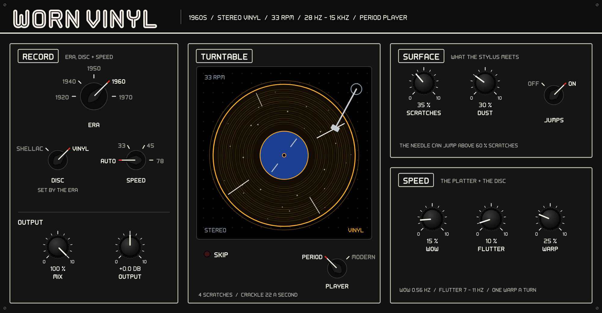

# Worn Vinyl — project notes

Stereo VST3 + AUv2 effect that plays a track back off a worn record: the
decade's playback chain (1920s–1970s, shellac or vinyl), scratches with the
needle sticking and skipping at high settings, dust (crackle, hiss, rumble),
wow, flutter and warp. Nothing is ported: a new plug-in scaffolded from
`~/DXi-DEv/vst3-port-template` with the `blank-vst3-plugin` skill on
10 Nov 2026, with the editor written straight away in R2Synth's black
("Polivoks") panel and Andy's 70s sci-fi lettering.

**Status:** all source written; DSP, layout and parameter suites pass in the
VM; every `.cpp` compiles to an object against the VST3 SDK 3.8.1 headers
and every `WornVinyl::` symbol referenced is defined. **Not yet built on the
Mac** — cmake, Xcode, the validator and `auval` cannot run from the session's
Linux VM. See *Verification* for what to run first.

---

## 1. The four scaffold decisions

| Decision | Choice |
|---|---|
| Effect or instrument | Effect (`aufx`), `PlugType::kFxDistortion` (where hosts file lo-fi / character effects), no event input |
| Bus layout | Stereo in / stereo out only. `setBusArrangements` accepts 2/2 and nothing else; `SupportedNumChannels` in `resource/au-info.plist` cut to the single 2/2 entry |
| Name and codes | See §2 |
| Editor now or later | **Now** — the look was part of the request, and an AU from this template must never ship without an editor anyway (MasterLoud §5a: the SDK 3.8.1 AU wrapper crashes the host when `createView` returns null) |

## 2. Identity — permanent once a build ships

| Field | Value |
|---|---|
| Display name | Worn Vinyl (factory `stringPluginName`) |
| `PLUGIN_NAME` / namespace | `WornVinyl` |
| Folder | `~/DXi-DEv/WornVinyl-VSTi` |
| Vendor | `AE Cobley` (no full stops) |
| AU name | `AE Cobley: Worn Vinyl` |
| VST3 bundle id | `audio.WornVinyl.vst3` |
| AU bundle id | `audio.WornVinyl.audiounit` |
| AU type / subtype / manufacturer | `aufx` / `WVnl` / `AECo` |
| Processor UID | `0x60BD0A8C, 0x000572B3, 0x73B3540F, 0xD31204EF` |
| Controller UID | `0x9BCDC74F, 0x5BB78CE2, 0x8D7E04B4, 0x39A6E4D6` |
| Version | 1.1.0.0 |

UIDs generated fresh with the skill's `os.urandom` one-liner on 10 Nov 2026.
**Never reuse or change them.**

`WVnl` clash check, 10 Nov 2026 — every `*/resource/au-info.plist` under
`~/DXi-DEv`: FDrm, FTrn, MLud, Prj6, SiSy, SmDr, SDub, SpyB, VcFl. `WVnl` is free.

`CMakeLists.txt`, `setup-xcode.sh` and `.gitignore` are **MasterLoud's**, not
the template's: they are the template plus the later fixes (universal
arm64 + x86_64 by default, `--native`, `-ffile-prefix-map` to keep build paths
out of the binary, installer ignores). Only the identity block was edited.
The template itself should get those fixes too.

## 3. Why the DSP is SDK-free

`WornVinylDsp.{h,cpp}` include no VST3 header. They compile with plain
`c++ -std=c++17`, so the sound is measured before anything is built
(`tests/DspTests.cpp`). And because VST3 splits processor from controller,
everything the panel shows that the DSP decides is **one function both
call**: `effectiveDisc`, `discLocked`, `rpmOf`, `profileOf` /
`bandwidthText`, `scratchSlot` / `activeScratches` (the turntable screen
draws the very scratches the stylus hits), `crackleRate`,
`jumpChancePerSecond`, `warpBump` (the arm lifts where the pitch swoops).

## 4. Parameters

Every row carries normalised, plain and internal ranges; internal == plain
(the slot is empty, not absent). **Append, never insert.**

| Id | Parameter | Range | Notes |
|---|---|---|---|
| 0 | Era | 1920s / 1940s / 1950s / 1960s / 1970s, default 1960s | |
| 1 | Disc | Shellac / Vinyl, default Vinyl | **heard in the 1950s only** — `effectiveDisc`: 1920s/40s shellac, 60s/70s vinyl. The parameter keeps its value, so the 50s remember the choice; the panel shows the switch locked and "SET BY THE ERA" |
| 2 | Scratches | 0–100 %, default 20 | 0 → 12 radial scratches; **jumps above 60 %** |
| 3 | Dust | 0–100 %, default 30 | crackle (rate ∝ dust²), surface hiss, rumble |
| 4 | Wow | 0–100 %, default 15 | once a turn, ±1.2 % at 100 %, plus the motor's 0.13 Hz drift (¼ of it) |
| 5 | Flutter | 0–100 %, default 10 | 7.3 + 11.1 Hz, ±0.4 % at 100 % |
| 6 | Warp | 0–100 %, default 0 | one high spot a turn: a ±4 % swoop, up to −2.5 dB and a dull moment |
| 7 | Jumps | Off / On, default On | may the needle stick |
| 8 | Mix | 0–100 %, default 100 | against the dry signal delayed by the same latency |
| 9 | Output | −12…+12 dB, default 0 | |
| 10 | Disc Angle | 0–1 | **output**, hidden: the turntable screen |
| 11 | Skipping | 0/1 | **output**, hidden: the SKIP lamp (latched in the controller) |
| 12 | Speed | Auto / 33 / 45 / 78, default Auto | **appended 10 Nov 2026**, a late setting (after the outputs). Auto = the disc's own speed (78 shellac, 33⅓ vinyl). Moves only the motor: scratch ticks, wow rate, warp, a stuck groove's length. The music keeps its pitch and tempo (tested) |
| 13 | Player | Period / Modern, default Period | **appended 10 Nov 2026**, a late setting saved after Speed. What the SURFACE sounds like: Period = the era's EQ again (dull crackle, how it sounded before), Modern = a 20 Hz – 20 kHz turntable (bright crackle over the old music). The music is bit-identical either way (tested) |
| 14 | Speaker | Off / 1920s Horn / 1940s 2-inch / 1950s 3-inch / 1960s 6-inch + Tweeter / 1970s 3-Way, default Off | **appended 24 Nov 2026**, a late setting saved after Player. What the record is heard through — see §5a. Off is no stage at all, so it is bit-identical to before (tested) |
| 1000 | Bypass | Off / On | through the DSP, so the latency holds |

**State v1:** `int32 version`, ten `double` settings, `int32 bypass`, then
`int32 speed`, `int32 player`, `int32 speaker` (appended without a version bump, so an older
build still opens a newer project; a stream without them is Auto / Period / Off). A short
stream resets what it omits to default; processor and controller read the
same layout. `setState` (UI thread) parks the values and the audio thread
takes them at the top of the next `process()` and snaps the smoothers — the
DSP is never touched from the UI thread.

## 5. The sound

```
input → ring buffer ─(read: 12 ms + wow + drift + flutter + warp + jump offset, Hermite)→
      → mono sum / stereo width of the era
      → THE RECORDING, music only: era EQ (2-pole HP, 4-pole Butterworth LP, two
        resonances - the 1920s horn) → lathe saturation (1−d)·x + d·tanh(1.5x)/1.5,
        at 4x (see Aliasing)
        → make-up gain (the EQ's mean power 125 Hz–4 kHz put back, −3…+9 dB)
      + THE SURFACE through THE PLAYER: hiss (shellac: band-passed 2.5 kHz roar;
        vinyl: soft and dark), rumble (25 Hz), crackle grains (ticks, 10 % pops),
        scratch ticks - through the era EQ again (Period) or 20 Hz–20 kHz (Modern)
      → warp: HF loss and level dip at the high spot (the stylus lifting: both)
      → THE SPEAKER (§5a): music and surface together; Off = no stage
      → Mix, Output, Bypass
```

**Why split (10 Nov 2026).** The era's colour is cut into the groove with the
music, but the dust and scratches are met at the stylus and only go through
the PLAYER. Before the split one EQ sat after the surface - the same as Period
today (measured: the clean-patch levels are unchanged; the surface alone is
within 1.5 dB, as it no longer takes the make-up gain or the saturation).
Modern is the sound of most transfers of old 78s: a 1920s surface measured
**9.1 dB** more treble than Period; a 1970s LP's only 0.8 dB (its band is
nearly modern anyway).

| Era / disc | Band | Width | Notes |
|---|---|---|---|
| 1920s shellac | 180 Hz – 3.2 kHz | mono | horn peaks +6 dB @ 1 kHz, +4 dB @ 2.3 kHz; loudest surface |
| 1940s shellac | 70 Hz – 5.5 kHz | mono | +3 dB @ 2.5 kHz |
| 1950s shellac | 60 Hz – 7 kHz | mono | |
| 1950s vinyl | 40 Hz – 11 kHz | mono | the first LPs |
| 1960s vinyl | 28 Hz – 15 kHz | 0.85 | |
| 1970s vinyl | 20 Hz – 18.5 kHz | 1.0 | quietest surface |

**Speeds:** on Auto, shellac 78 rpm (a turn every 0.77 s), vinyl 33⅓ (1.8 s);
the Speed switch can turn any disc at 33⅓, 45 or 78 (`turntableRpm`). The
scratches, the wow and the warp all follow the turn. Nothing turns slower
than 33⅓, which is what the ring buffer is sized for (tested).

**Jumps.** Only at the deepest scratch (slot 0), only above 60 % with Jumps
on; the chance rises as ((s−60)/40)² / 6 a second (≈ one stick every 6 s at
100 %). A stick jumps the read head back one turn (we hear the last turn
again) 1–4 times, then skips forward to where the music is now — no latency
needed, because the needle only ever goes back first. Each jump is a 6 ms
crossfade plus a stylus-landing thump. The ring buffer holds four LP turns
(≈ 4 MB at 48 k, 16 MB at 192 k), allocated in `setSampleRate` only.

**Deterministic:** our own SplitMix64, re-seeded by `reset()` — the same
audio is the same bounce, at any block size (tested).

**Transport (10 Nov 2026).** The processor asks for `needTransportState ()`
and calls `Dsp::setTransport` every block. The record turns only while the
song plays: stopped, the motor stops (disc and screen freeze, no wow or
flutter), the surface fades out in 30 ms (measured −210 dBFS 0.2 s later from
−31 playing), no new crackle or ticks, and a stuck needle lets go without a
thump. The music still passes, so a stopped track can be monitored. On every
start and every jump in song position (a loop, a locate) the disc angle,
flutter and drift phases and the random seed are set **from
`projectTimeSamples`**, and the crackle grains and noise filters start empty:
the same passage gets the same scratches every time (tested bit-identical
across different histories, and across a loop). A host with no
ProcessContext: always turning, as before.

## 5a. The speaker (24 Nov 2026)

Last in the wet chain, so the music **and** the surface come out of it (a
1920s surface on a Modern deck comes out of the horn 8 dB less bright —
tested). Chosen freely, not tied to the era. Per channel:

```
[at 4x: amp soft clip (1−d)x + d·tanh(1.5x)/1.5 → cone excursion (the band
under coneHz through tanh(kx)/k)] → 2 HP + 2 LP + 4 peaks → cabinet / horn echo
(fed back through a one-pole LP) → make-up (125 Hz–4 kHz mean power, ±9 dB)
```

| Speaker | Band (re 1 kHz, measured) | Character | Mono? |
|---|---|---|---|
| 1920s Horn | 150 Hz −20, 10 kHz −32 | soundbox peaks 700 / 1.5 k / 2.8 k; a 3.2 ms echo down the horn (310 Hz combs) | mono |
| 1940s 2-inch | 150 Hz −27, 3 kHz **+9**, 10 kHz −23 | shouty break-up; cone and valve give out (400 Hz THD 6 % loud, 0.01 % quiet) | mono |
| 1950s 3-inch | 150 Hz −14, 10 kHz −15 | smoother, a soft case thump at 180 Hz | mono |
| 1960s 6-inch + tweeter | 60 Hz −12, 150 Hz +5, 10 kHz 0 | open-back portable: box boom, 450 Hz dip, tweeter sparkle at 6.5 k | mono |
| 1970s 3-Way | ±2 dB 60 Hz–10 kHz | 8-inch sealed bass, 3 kHz crossover dip, dome tweeter | **stereo** |

1 kHz level within 2.2 dB of the line out for all five. One cabinet sums to
mono (a 1970s stereo LP on a Dansette is mono). A speaker change fades like
an era change (8 ms out, swap, in). The echo buffer is sized in
`setSampleRate`; `designProfile` (which can run on the audio thread)
allocates nothing — `speakerMakeup` designs a copy that only reads the
echo's length. Cost with the stereo 3-way and everything at 100 %: 2.2 % of
a VM core (0.7 % before the oversampling).

**Aliasing (24 Nov 2026).** A host's test: a 10 kHz tone gave an 18 kHz
component at −54.2 dBc (6-inch speaker) - the third harmonic (30 kHz)
folding back at 48 k. Reproduced exactly; the bigger source was the lathe,
always on (−47 dBc at −6 dBFS, −41 at −1 dBFS, speaker off). Every curve
that bends the signal - the lathe, the speaker's amp and cone - now runs in
an `Oversampler4x`: two polyphase IIR half-bands up and two down (hiir's
design, 9 + 6 coefficients, 100 dB stopband, flat to 0.001 dB to 20 kHz),
the curve at 4x between them. Measured: below −146 dBc for every era ×
every speaker at −6 and −1 dBFS (`testAliasing`, beside the naive curve
at −47 dBc as its negative control). The linear filters stay at 1x.

The half-bands DELAY: ~5.3 samples at the base rate, at every rate
(`Oversampler4x::delaySamples`, an impulse's centre of mass). Caught at once
by the latency guard (582.6 measured vs 576). The read head now reads that
much earlier - once for the lathe, again while a speaker is on, rounded to
whole samples so a still record is still read exactly - and changes only
inside the era/speaker fade. Without it Mix 50 % combed (−12.5 dB at 5 kHz;
tested at 3 and 5 kHz, with and without a speaker).

## 6. Deliberate omissions, and the trap each one hides

| Omitted | Why | What bites when it is undone |
|---|---|---|
| Tempo in `processContextRequirements` | The record turns at its own speed; only `needTransportState ()` is asked for (since 10 Nov 2026) | Since VST3 3.7 the context is opt-in; reading tempo without `needTempo ()` silently gives 120 |
| Messages | None needed | A message sent from `process()` is discarded by the host's connection proxy — per-block values go out as the hidden outputs |
| Controller editor list | The editor polls at 30 Hz | In `editorDestroyed`, `dynamic_cast` is null inside `~EditorView()` — compare upcast pointers |
| `restartComponent (kLatencyChanged)` | Latency (12 ms) depends only on the sample rate | If it ever changes while active, the host keeps the old compensation |
| Worn-panel marks (R2Synth's `PanelWear.h`) | Tied to R2Synth's layout | Port it if wanted — it would suit the name |
| Era change crossfade | Wet fades out 8 ms, the chain swaps, fades in 8 ms — a short dip, no click | A crossfade between two chains would need a second EQ pair |

Also seeded: `kBypass` = 1000 with every id range-checked; never a null title
or units to `RangeParameter`; `numSamples == 0` handled; 64-bit hosts via
scratch buffers sized in `setupProcessing`; `RTLD_NODELETE` pin from
MasterLoud in the entry file.

## 7. The editor — design 1, the black panel



1000 × 520 (480 until PLAYER needed room under the screen). SPEAKER (24 Nov
2026) sits left of PLAYER under the screen — a **6-position** selector
(OFF · HORN · 2 IN · 3 IN · 6 IN · 3-WAY at −90/−54/−18/18/54/90°, names
hung at radius + 15, not + 12, or the top two touch the ticks: a negative
control proves it) — and the SKIP lamp moved up into TURNTABLE's title row
to make room. The header line ends with the speaker ("/ 6-INCH + TWEETER")
when one is on. `WornVinylLayout.h` (VSTGUI-free, read by the tests) has every
rectangle, the selector geometry (2 to **6** positions — Era's are
at −90/−45/0/45/90°, Speed's four at −90/−30/30/90°, Speaker's six above) and the readout formatters; `WornVinylPanelViews.*` has
R2Synth's `Knob` and `RotarySwitch` (wear removed; the switch can be
**locked**), plus `Turntable`, `Lamp`, `TextLine`, `Backdrop`.
`SciFiLettering.h` is R2Synth's, namespace changed only. No bitmaps, no
system font. In public material: "70s sci-fi lettering" only.

**`docs/panel.png`** (24 Nov 2026) is drawn by `tools/render-panel.py`, as
R2Synth's is: `tools/dump-layout.cpp` compiles against `WornVinylLayout.h`,
`WornVinylParams.cpp` and `WornVinylDsp.cpp` and prints the panel at its
defaults as JSON (positions, text, the scratches and specks at disc angle 0,
every glyph), and the script only draws. What a selector prints
(`positionName`), what a knob reads (`knobReadout`) and the era's label
colours (`eraLabelColour`) moved into `WornVinylLayout.h` for it, so the
editor, the tests and the picture read one copy. Needs Pillow and the SDK
headers. `Designs/WornVinyl-1-BlackPanel.png` stays as the design mock-up.

The **turntable screen** turns the disc to the published `Disc Angle`; the
label marks show it turning; scratches are drawn at `scratchSlot` phases
and pass under the stylus exactly when they tick; specks follow Dust; the
arm's head grows over the warp's high spot; STUCK shows in red while the
needle is stuck. Era label colours are generic period colours, no company's.

## 8. Verification (VM, 10 Nov 2026)

```sh
tools/run-tests.sh                       # DSP 223, Layout 1104, Params 156 — 0 failed (24 Nov 2026)
SDK=external/vst3sdk   # (in the VM: a clean 3.8.1_build_84 clone)
for f in source/*.cpp; do
  g++ -c -std=c++17 -DLINUX=1 -DRELEASE=1 -I$SDK -I$SDK/vstgui4 -Isource -o /tmp/$(basename $f .cpp).o $f
done
nm -C /tmp/*.o | grep " U " | grep "WornVinyl::"   # all 43 defined in the objects (a weak `V` vtable counts as defined)
```

Measured: default patch with a −12 dBFS 1 kHz sine → output peak **−9.1 dBFS**
(−8.5 in the Mac's Linux VM: the crackle peaks; same seed, but another libm's
`exp`/`tanh` round differently, so a bounce is identical on one machine, not
bit-identical across machines), RMS −15.1 (unity). 1 kHz through each era within
±0.5 dB except the 1920s, **+4.3 dB** (the horn's 1 kHz peak; broadband
material comes out near unity). Surface alone at default dust: −42 dBFS RMS
(1920s) to −57 (1970s). Pitch at 100 %: wow 1.52 %, flutter 0.41 %, warp
4.03 %. Worst case (everything 100 %, full-scale noise, +12 dB): finite, read
head never closer than 129 samples. Cost: 1.4 % of one VM core at 48 k with
everything at 100 %.

**Latency, as a host measures it (24 Nov 2026).** A host's test reported
"576 smp, measured 627". Not a bug: Wow and Flutter MOVE the read head, so
at the defaults a burst comes out anywhere in 526 – 628 samples (most of it
the motor's 0.13 Hz drift, which a short test sees as a constant offset).
`testMeasuredLatency` measures it the host's way (noise bursts,
cross-correlation): with nothing moving, measured = reported at 44.1 / 48 /
96 k (within 0.05 ms - the era low-pass's own ~0.03 ms group delay, which
no plug-in reports); with the default wow and flutter, the mean over three
drift cycles = the still value, so the reported latency is right on
average. Checked by breaking it on purpose: a latency misreported by 5
samples, and a wow with a DC offset, both fail. To check a host's figure,
set Wow, Flutter and Warp to 0: it should read 576 – 578 at 48 k.

**Xcode 27 (24 Nov 2026).** After the macOS / Xcode 27.2 upgrade the configure
failed with "No CMAKE_C_COMPILER could be found": the deployment target was
10.13 and Xcode 27 accepts 12.0 – 27.2 only. `CMAKE_OSX_DEPLOYMENT_TARGET` is
now **12.0** (above `project()`), and CMakeLists.txt raises Apple's
AudioUnitSDK project from 11.0 to 12.0 on every configure (the AU target's
nested PreBuild xcodebuild would fail otherwise; `external/` is never edited
by hand). Worn Vinyl now needs **macOS 12.0 or later** — the first release
notes must say so. A cache from before the change must go: `rm -rf build`.

**On the Mac, first:**

```sh
cd ~/DXi-DEv/WornVinyl-VSTi && ./setup-xcode.sh      # clones the SDK into external/ (in-tree)
# build, then:
validator build/VST3/Release/WornVinyl.vst3
auval -v aufx WVnl AECo
```

## 8a. Releasing (24 Nov 2026)

`installer/` is R2Synth's, renamed (NAME `WornVinyl`, ids
`audio.WornVinyl.vst3` / `.audiounit`, `auval -v aufx WVnl AECo`):

```sh
installer/build-release.sh              # tests, clean universal build, checks, ONE signed, notarised pkg
installer/verify-install.sh             # after installing it (on a Mac that never had the build tree)
installer/publish-release.sh --dry-run  # every check, nothing pushed
installer/publish-release.sh            # checksum into the notes, push, tag the BUILD commit, GitHub Release
```

`installer/README.md` is the walkthrough (certificates, notary profile, the
dead-AU symlink trap, Gatekeeper). Differences from R2Synth: MasterLoud's
rule that the licence pane appears only when there is a `LICENSE` file -
there is now: **GPL v3 or later** (24 Nov 2026, as R2Synth; `NOTICE.md` has
the section 7(e) name term, the third-party licences and the credits;
`version.h` said CC BY-SA 4.0 until then); no presets, so that
component is dropped (the distribution trimmed of both was checked
well-formed with exactly the VST3 and AU pkg-refs). `tools/check-versions.py`
came with it. `tools/run-tests.sh` now also runs it and the release scripts'
stubbed refusals (22 + 18 cases). `installer/release-notes-1.0.0.0.md` is
drafted, with the SHA-256 placeholder `publish-release.sh` fills in.
Notary profile: `project6-notary`, the one all the plug-ins share.

## 9. The SDK

In-tree (`external/`, git-ignored), the default: this plug-in may ship on
its own, so it should not depend on another project's checkout.
