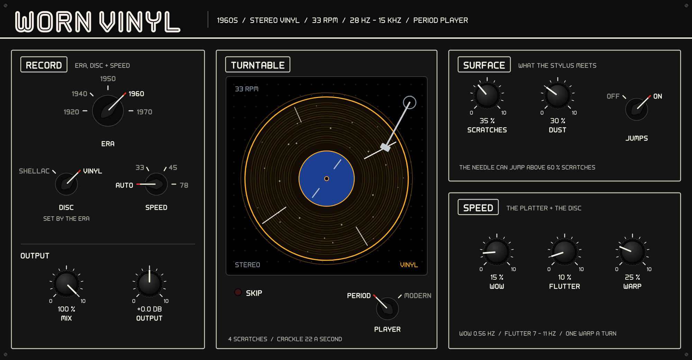

# Worn Vinyl

Your track played back off a worn record. A stereo effect, VST3 and Audio
Unit, for macOS.



## What it is

* **The decade's sound.** **Era** picks the 1920s, 1940s, 1950s, 1960s or
  1970s, and the music takes on that decade's recording chain: its
  bandwidth (from 180 Hz – 3.2 kHz for an acoustic 78 up to 20 Hz – 18.5 kHz
  for a 1970s LP), its resonances, the cutting lathe's saturation, and mono
  or stereo. **Disc** chooses shellac or vinyl in the 1950s, the one decade
  that had both. In every other decade the era decides it.
* **The disc turns.** The faults come round once a turn, at 78 rpm for
  shellac and 33⅓ for vinyl, or at whatever **Speed** sets (33, 45, 78).
  The music keeps its own pitch and tempo. The record turns only while the
  host is playing, and its position follows the song, so a passage gets the
  same scratches every time it plays.
* **Scratches.** Up to twelve radial scratches tick as they pass the
  stylus. Above 60 % the needle can **stick** at the deepest one, replaying
  the last turn one to four times before it skips on. **Jumps** turns that
  off.
* **Dust.** Crackle and pops, surface hiss (a shellac roar or a soft vinyl
  hiss) and platter rumble.
* **Wow, Flutter and Warp.** Wow is an off-centre hole, once a turn, plus
  the motor's slow drift. Flutter is a tired idler at 7 and 11 Hz. Warp is
  one high spot a turn: the pitch swoops, the level dips and the top end
  dulls as the stylus lifts.
* **Player.** **Period** plays the surface noise through the era's own
  band, so the crackle is as dull as the music. **Modern** plays it through
  a modern turntable, bright crackle over the old sound, the way most
  transfers of 78s sound.
* **Speaker.** What it all comes out of: a 1920s hand-cranked horn
  gramophone, a 1940s 2-inch speaker, a 1950s 3-inch, a 1960s 6-inch with a
  small tweeter, or a 1970s hi-fi 3-way. Each has its own band, cone or
  horn, cabinet and amplifier, and the small ones distort when pushed. All
  but the hi-fi are mono. **Off** is the line out.
* **The turntable screen** shows the disc turning at its real speed, the
  scratches arriving at the stylus as you hear them, the dust, and the arm
  lifting over the warp. The SKIP lamp lights when the needle sticks.
* **Mix** against the dry signal, and **Output**, −12 to +12 dB.

13 parameters, all automatable, plus the host's bypass. At the default
settings a −12 dBFS sine comes out at the same RMS level. The latency is
12 ms, reported to the host.

`Designs/WornVinyl-SignalFlow.html` draws the signal flow.

## Building

You need macOS 12.0 or later, Xcode with its command-line tools, and CMake.

```sh
./setup-xcode.sh
```

The first configure downloads the VST3 SDK and Apple's AudioUnitSDK into
`external/`. The build installs the VST3 and the AU into
`~/Library/Audio/Plug-Ins/`. Then check both:

```sh
validator build/VST3/Release/WornVinyl.vst3
auval -v aufx WVnl AECo
```

If a configure fails after an Xcode upgrade, delete `build/` and run
`./setup-xcode.sh` again: the old settings are cached there.

## Tests

```sh
tools/run-tests.sh            # the DSP, layout and parameter suites; no build needed
```

The DSP suite builds with nothing but a C++ compiler. It measures every era,
speaker and fault before any plug-in is built. See `PORTING-NOTES.md` for
what was measured, what was decided, and why.
